# MR-ART Image Quality Assessment — v2

Follow-up work after feedback from **Dr. İlkay Öksüz (PIMI Lab, ITU)** on my first submission (see the repository root for v1).
Task: predict the **3-level expert quality score** (1 = good, 2 = medium, 3 = bad) of T1-weighted brain MRI scans from the
[MR-ART dataset](https://openneuro.org/datasets/ds004173) (148 subjects, 436 scans).

Feedback addressed in this version:
1. **Data augmentation** (~4×) with transformations that do not change image quality (flips, 90°/180°/270° rotations)
2. **Understand the MRIQC features** the classical model relies on
3. **3D models** instead of 2.5D slices
4. **Literature review** of related challenges and papers
5. **Synthetic images generated by quality level**, following the k-space approach of Oksuz et al. (2019)

## Experimental design

| | |
|---|---|
| Split | Subject-level, `StratifiedGroupKFold`, seed 42 → 95 / 23 / 30 subjects (280 / 69 / 87 scans). No subject appears in two splits (asserted). See `splits/split_seed42.csv`. |
| Preprocessing | Reorient to RAS → divide by 99.5th percentile, clip to [0, 1] → zero-pad to a cube → resize to 128³ (2 mm isotropic). **No skull stripping** (the background carries the strongest artefact signal, see below). |
| Training | Class-weighted cross-entropy, AdamW (lr 1e-4), **early stopping** on validation balanced accuracy (patience 8), best-epoch checkpoint, left–right flip TTA at test time. |
| Augmentation | On-the-fly, train set only, 4 random views per scan per epoch. |
| Robustness | 3 seeds per configuration; subject-level paired bootstrap (2000×) for model comparison. |
| Metrics | Balanced accuracy, macro-F1, one-vs-rest AUROC, quadratic weighted kappa, per-class recall. |

## Results (test set: 87 scans / 30 subjects)

**Classical ML on 68 MRIQC features**

| Model | Bal. acc | Macro-F1 | AUROC | QW kappa |
|---|---|---|---|---|
| Logistic Regression | 0.708 | 0.699 | 0.866 | 0.808 |
| Random Forest | 0.756 | 0.748 | 0.897 | 0.841 |
| XGBoost | 0.717 | 0.707 | 0.897 | 0.818 |

RF 5-fold grouped CV on train+val: 0.769 ± 0.043. The most important features are **background statistics**
(`summary_bg_stdv`, `summary_bg_p95`): motion causes ghosting along the phase-encoding direction, which lands in the air around the head.

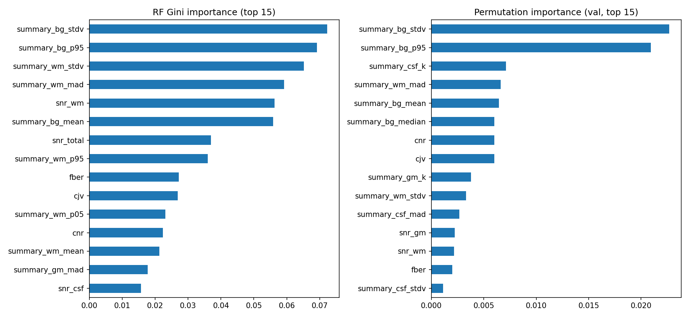

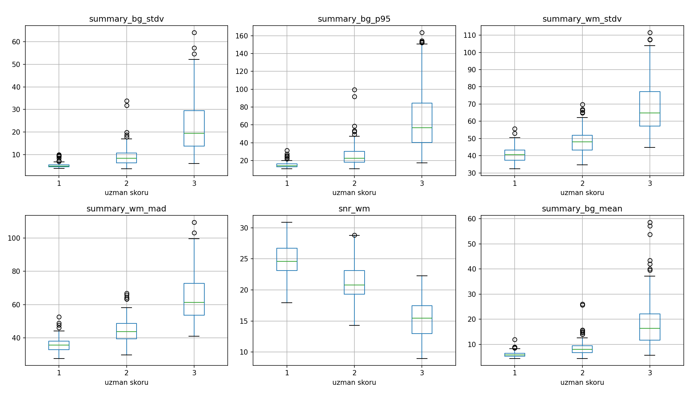

**3D CNN (r3d_18, Kinetics-400 pretrained) — augmentation ablation, mean ± std over 3 seeds**

| Augmentation | Bal. acc | QW kappa | AUROC |
|---|---|---|---|
| none | 0.792 ± 0.042 | 0.856 ± 0.043 | 0.911 ± 0.019 |
| flip | 0.791 ± 0.023 | 0.856 ± 0.026 | 0.903 ± 0.008 |
| **flip + rot90** | **0.813 ± 0.013** | **0.881 ± 0.009** | **0.929 ± 0.003** |

Augmentation mainly reduced seed-to-seed variance (~3×) and consistently raised AUROC; without it the model memorised the
training set (train accuracy > 95%).

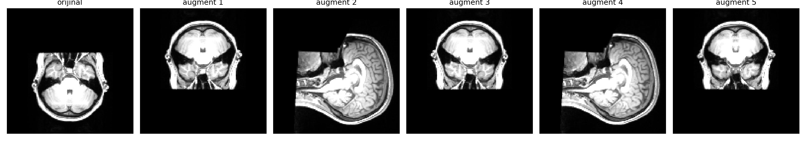

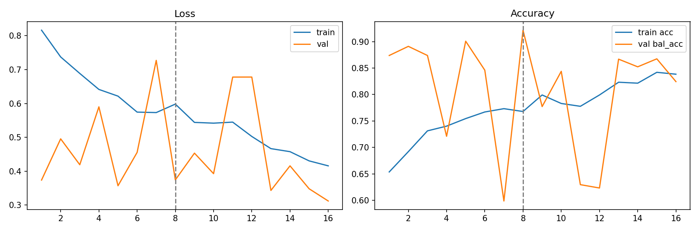

**3D architecture comparison (flip + rot90)**

| Model | Pretraining | Bal. acc | QW kappa | AUROC |
|---|---|---|---|---|
| **r3d_18** | Kinetics-400 (video) | **0.813 ± 0.013** | **0.881 ± 0.009** | **0.929 ± 0.003** |
| MedicalNet ResNet-18 | 23 medical 3D datasets | 0.780 ± 0.052 | 0.844 ± 0.036 | 0.900 ± 0.018 |
| MedicalNet ResNet-18 + z-score input | 23 medical 3D datasets | 0.719 ± 0.039 | 0.806 ± 0.031 | 0.878 ± 0.016 |
| DenseNet121 (1 seed) | none | 0.761 | 0.828 | 0.889 |

**Ensembles and statistical comparison**

- Seed ensemble of r3d_18 (flip + rot90): bal. acc 0.818, kappa 0.883, AUROC 0.930.
- RF + CNN probability average: bal. acc 0.831, kappa 0.890 (exploratory — chosen after looking at the test set).
- CNN vs RF, paired bootstrap: Δ bal. acc = +0.055, 95% CI [−0.019, 0.128]; CNN better in 93% of resamples, **not significant at 95%**.
- Binary views for comparison with the literature: good vs medium+bad acc 0.897 / AUROC 0.948; good vs bad (medium removed) acc 0.984 / AUROC 0.999.

## Where does the model look? (occlusion test, 3-seed ensemble)

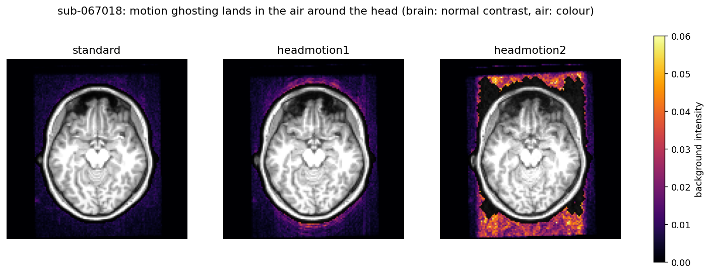

| Input | Bal. acc | QW kappa |
|---|---|---|
| Original | 0.827 | 0.891 |
| **Background removed (head only)** | **0.509** | 0.414 |
| Head removed (background only) | 0.704 | 0.612 |
| Lower face / defacing region removed | 0.818 | 0.883 |

Both the MRIQC model and the CNN rely mostly on **ghosting in the air around the head**. This is a physical signature of motion,
but it is also a generalisation risk (e.g., scanners that mask the background or skull-stripped data).

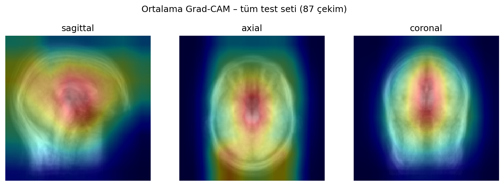

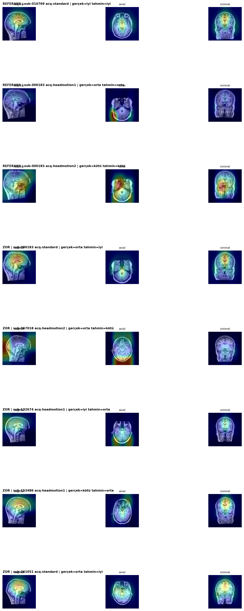

## Error analysis — the "medium" class

- 6 of the 7 test scans acquired **without instructed motion** (`standard`) but rated **medium** by the expert were predicted "good".
- Their MRIQC features also lie at the clean end of the medium class.
- In the CNN embedding space (t-SNE + class templates, inspired by AutoMAC-MRI), **24 of 26** such scans (train + test) sit in the
  "good" cluster — even though 19 of them were seen with the "medium" label during training.
- Interpretation (hypothesis): the expert score may reflect factors other than motion, or label ambiguity at the class boundary.

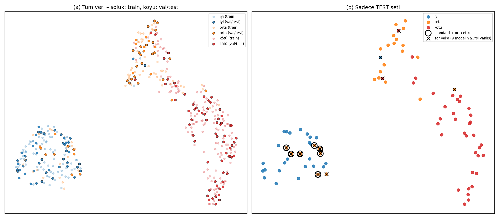

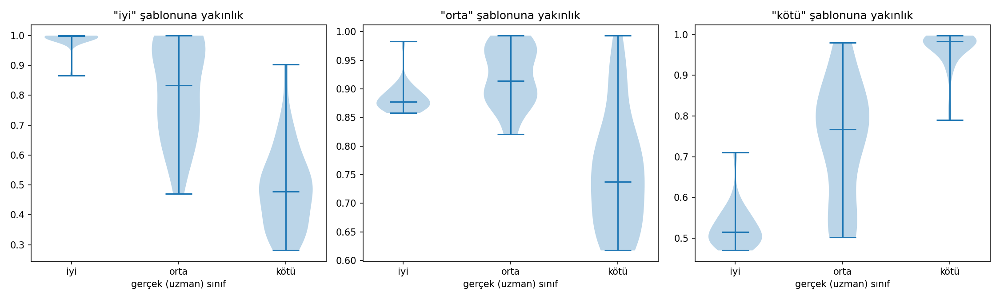

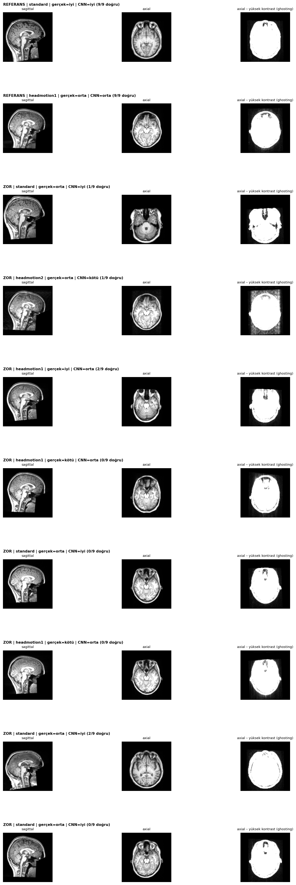

## Synthetic images generated by quality level (k-space, after Oksuz et al. 2019)

Clean training scans are corrupted in k-space: the head follows a random-walk rigid trajectory (pitch rotation + 3D translation)
and k-space lines along the A–P phase-encoding axis acquired after motion onset are taken from the moved image. Severity is
controlled by the number of segments and step size (*mild / moderate / severe*). Defacing is re-applied after simulation.
Only **training** subjects are used as sources (75 clean scans → 450 synthetic volumes).

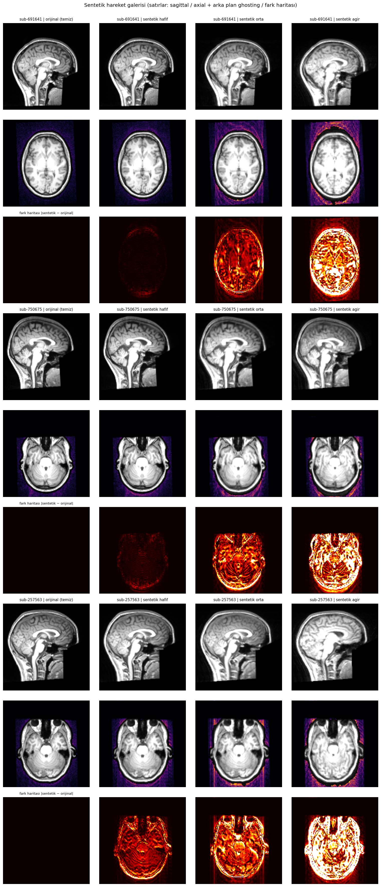

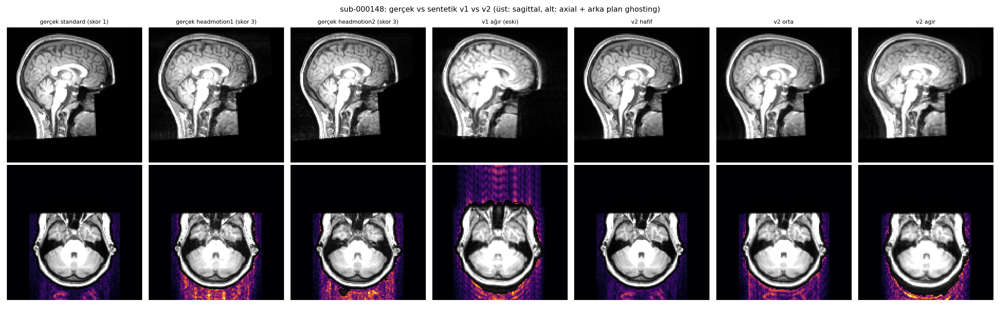

Validation — the trained classifier grades the generated images monotonically with the requested severity:

| Generated | pred. good | pred. medium | pred. bad |
|---|---|---|---|
| clean source | 100% | 0% | 0% |
| synthetic mild | 56% | 44% | 0% |
| synthetic moderate | 0% | 41% | 59% |
| synthetic severe | 0% | 0% | 100% |

Background statistics of the synthetic levels also fall between/on the real classes (e.g., severe: bg_p95 0.0183 vs real "bad" 0.0182).

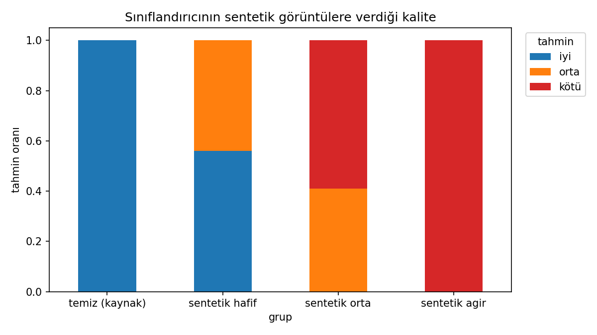 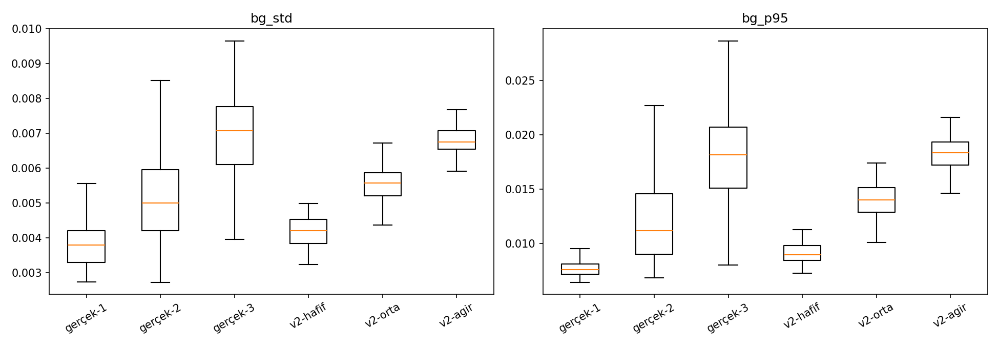

Using the synthetic data for **pretraining** (4-class severity task, then fine-tuning on real data):

| | Bal. acc | QW kappa | AUROC | Medium recall |
|---|---|---|---|---|
| Baseline (3 seeds) | 0.813 ± 0.013 | 0.881 ± 0.009 | 0.929 | 0.564 |
| Synthetic + curriculum (2 seeds) | 0.793 ± 0.033 | 0.861 ± 0.014 | 0.926 | 0.577 |
| Synthetic + random order (2 seeds) | 0.822 ± 0.006 | 0.887 ± 0.006 | 0.910 | 0.577 |

Pretraining sped up fine-tuning but did not meaningfully change final performance or medium-class recall; curriculum did not beat random order on this dataset.

## Limitations
- Small test set (30 subjects); several differences are within seed variance or bootstrap CIs.
- Single subject-level split for deep models (no nested CV).
- 2 mm resolution may hide subtle in-brain blurring.
- Grad-CAM on r3d_18 is coarse (≈16×8×8 grid); the occlusion test is the stronger evidence.
- Synthetic motion: magnitude-only simulation, linear k-space ordering, pitch rotation + translation only.

## Repository contents
- `notebooks/mrart_quality_v2.ipynb` — all code (Google Colab, A100)
- `splits/split_seed42.csv` — subject-level split
- `results/` — metrics (`*_metrics.json`), per-scan predictions, comparison tables
- `figures/` — all figures
- Large files (cached volumes, model weights) are not included.

## How to run
1. Open the notebook in Google Colab (GPU runtime; A100 recommended — T4 is ~6× slower for 3D training).
2. `pip install -r requirements.txt`
3. Run the cells in order; the first cell downloads MR-ART from OpenNeuro to Google Drive.

## Use of AI tools
I used **Claude (Anthropic)** extensively as a coding and research assistant: writing and debugging code, suggesting experiment
designs and analyses, and literature search. I ran all experiments in Colab, checked the outputs, and made the decisions on what to
run next and how to report the results. _[Edit this section so it accurately describes your own contribution.]_

## References
- Nárai et al., *Movement-related artefacts (MR-ART) dataset*, Scientific Data 2022.
- Esteban et al., *MRIQC*, PLoS ONE 2017.
- Oksuz et al., *Automatic CNN-based detection of cardiac MR motion artefacts using k-space data augmentation and curriculum learning*, Medical Image Analysis 2019.
- Wang et al., *CMRxMotion challenge results*, arXiv:2507.19165.
- Vakli et al., *Automatic brain MRI motion artifact detection based on end-to-end deep learning is similarly effective as traditional machine learning trained on image quality metrics*, Medical Image Analysis 2023.
- Jerald et al., *AutoMAC-MRI*, arXiv:2512.15315.
- Tran et al., *A closer look at spatiotemporal convolutions* (r3d_18), CVPR 2018; Chen et al., *MedicalNet*, 2019.
